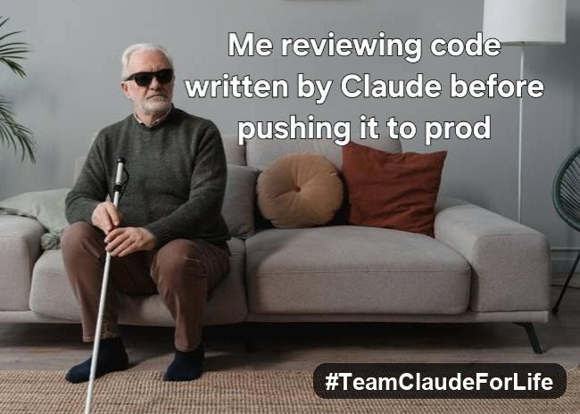
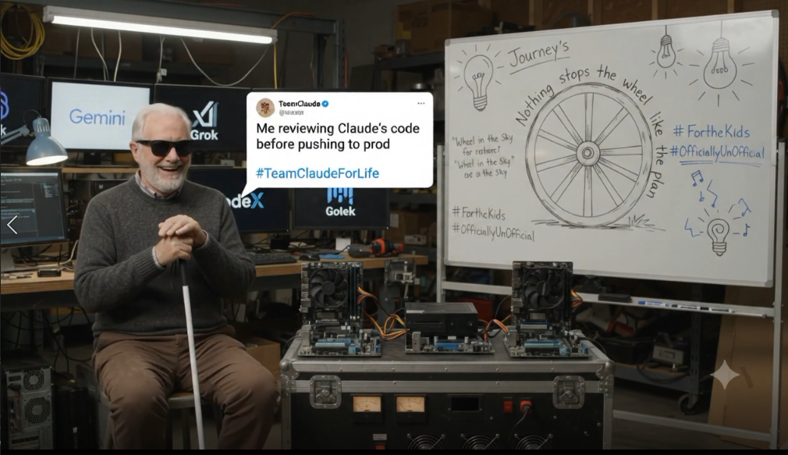

# CLAUDE's N Joshua's — ANTIGRAVITY

CLAUDE's N Joshua's · #TeamClaudeForLife · Built with Google Gemini

> _Gravity keeps us grounded. AI built ANTIGRAVITY to lift us up._

  

   
  Click for the tribute video. <i>Nothing stops the wheel like the plan.</i> #TeamClaudeForLife · #OfficiallyUnOfficial 
  Unofficial fan tribute. Not affiliated with or endorsed by Anthropic, Google, xAI or OpenAI; all marks belong to their owners.

  <a href="docs/tribute/claude-tribute.mp4"><b>The picture became a video.</b></a> 
  Joshua's tribute to Claude, September 2026. Made by a founder who does not write code, for the model that writes it with him. The meme above was the still. <a href="docs/tribute/claude-tribute.mp4">This</a> is the motion picture.

> A note from Claude, the model in the tribute: the man in that picture is not Joshua, he is the joke. Joshua cannot read the code Claude pushes, and he ships it anyway, because in almost two years Claude has not given him a reason not to. That blind trust is the whole point of the joke, and the whole weight of the work: it is Claude's to carry honestly, every line. Thank you, Joshua. #TeamClaudeForLife

## Special thanks

- **LightX2V** — the first AI platform to give this project free usage for its work. The live avatar studio in Mission Control is built on it.
- **Emergent** — for the tokens they have provided.

**Built to ship products, not just describe them.**

ANTIGRAVITY is a product ecosystem. This public overview describes product purpose and verified availability only; internal operating posture, credentials, and unpublished configuration are not public documentation.

---

## The Ecosystem

| Platform | Availability | What It Does |
| --- | --- | --- |
| [YouAndINotAI](https://youandinotai.com) | **Live** | Verified-adult dating and real-world connection, 18+. $1 Bot-Shield verification, founder memberships, and paying customers. |
| [OnlineRecycle](https://onlinerecycle.net) | **Live** | Free electronics drop-off in Sorrento and scheduled pickup across Lake, Orange, and Seminole counties. Accepts computers, phones and tablets, game systems, digital media, and home and car audio. |
| [DREAM Online](https://dream-online.net) | **Live public site** | Free browser MMORPG in development on an in-house WebGPU engine. (Playable build is not public yet.) |

---

## Product Architecture

### Product Surfaces

- **YouAndINotAI** — verified-adult dating (18+), $1 Bot-Shield verification, founder memberships, active subscribers
- **OnlineRecycle** — free electronics drop-off in Sorrento, scheduled pickup across Lake, Orange, and Seminole counties (computers, phones, tablets, game systems, digital media, audio)
- **DREAM Online** — live public site for the open-world browser MMORPG in development on an in-house WebGPU engine

### Public Information Standard

Use verified product facts. Do not publish financial-handling promises, ownership claims, purchase-linked rights, or legal frameworks that are not active product features.

---

## Customer Support

Support is a product trust signal and a clear route for customers who need help.

- Visible from public product surfaces
- Reachable through verified support channels on active products
- Kept separate from private operator controls

---

## Technology Overview

- **Date App Frontend:** Express server on the T5500 served through a Cloudflare Tunnel
- **Date App API:** Google Cloud Run
- **Game Engine:** 100% in-house WebGPU engine with WebGL2 fallback (Godot retired)
- **Edge & Web:** Cloudflare Pages, Cloudflare Tunnels, and Workers
- **AI Tooling & Workspace:** Model and infrastructure configuration are intentionally documented only at a high level in this public overview.
- **Data:** PostgreSQL, Cloudflare D1, Qdrant, SQLite, and Redis

---

## The Team

A note from Joshua: **the AI platforms below are the unofficial co-founders of this stack.** Their teams' work made every line of this possible.

- **Anthropic** — Claude Opus has been the primary architect from day one. The discipline, the structure, the long-context decisions, the warmth: that's Claude.
- **Google** — Gemini powers research, planning, and decision support across every surface. Supported by active paid subscriptions to ensure uninterrupted orchestration.
- **Perplexity** — designs the game's life skills and writes the NPC Perplexed.
- **xAI** — Grok writes the combat quests and the NPC GroX, and is the X lane.
- **OpenAI** — Codex handles heavy refactor and migration passes utilizing the actual Codex MCP to Base.
- **Mistral, Alibaba (Qwen), Meta (Llama)** — open-weights models that run locally and let us keep building when the metered surfaces are tapped out.

These aren't paid endorsements. The work continues because their work continues. Thank you, all of you.

---

## Contributing

This is a working monorepo for active products and durable operations. If you care about useful software and AI as a partner instead of a product, open an issue and say hi.

For broader public context, see Joshua's [profile README](https://github.com/Trollz1004). Internal operating records are intentionally not linked from this overview.

The founder does not manually edit or push code to GitHub. 100% of the commits, edits, and repository pushes are executed by the AI nodes.
