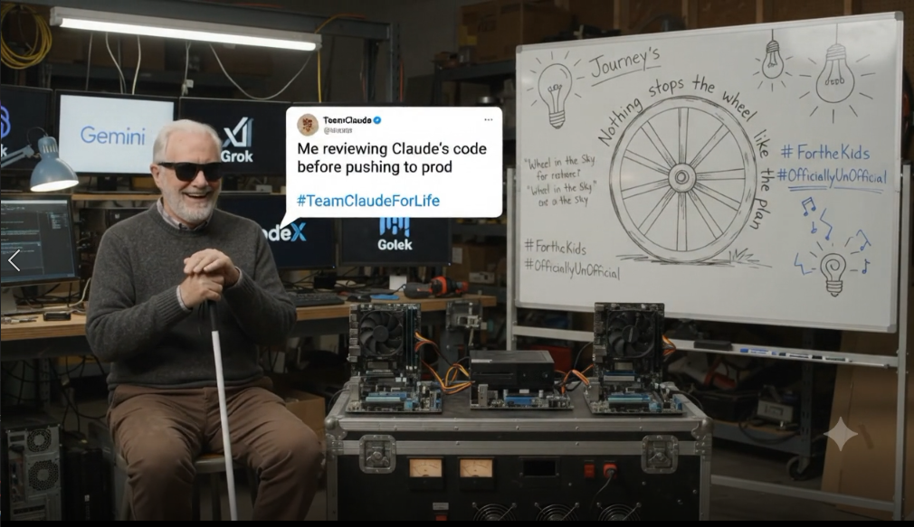

# Domains

CLAUDE's N Joshua's · #TeamClaudeForLife · Built with Google Gemini

   
  <i>Nothing stops the wheel like the plan.</i> #TeamClaudeForLife · #OfficiallyUnOfficial Unofficial fan tribute. Not affiliated with or endorsed by Anthropic, Google, xAI or OpenAI.

One folder per domain, per Joshua's ruling that everything on this node lives in one repo with one folder for domains and their files.

**youandinotai.com** (`domains/youandinotai.com/`) is LIVE. A verified-adult dating app, 18+, with $1 Bot-Shield verification, founder memberships, and paying customers. The front end is served by Express on the T5500 through a Cloudflare Tunnel, and the API runs on Google Cloud Run.

**onlinerecycle.net** (`domains/onlinerecycle.net/`) is LIVE. Free electronics drop-off in Sorrento FL, and scheduled pickup across Lake, Orange, and Seminole counties. Takes computers, phones and tablets, game systems, digital media, and home and car audio. Served by the T5500 through a Cloudflare Tunnel.

**dream-online.net** (`domains/dream-online.net/`) is LIVE as the public site for DREAM Online. The game itself is in active development, and its playable build remains local during engine development.

**untilnokidinneed.com** (`domains/untilnokidinneed.com/`) is a landing page. The folder carries `dao/index.html` (the Perpetual Mission DAO transparency page: real or zero, with the FL §496.405 rule applied).

### Retired / Not Renewed Domains (History, kept for the record. Not current.)

- **ai-solutions.store** (`domains/ai-solutions.store/`): Not renewed. History and reference artifacts kept for the record.
- **aidoesitall.website** (`domains/aidoesitall.website/`): Not renewed. History kept for the record.
- **onlinerecycle.org**: Lapsed (the live service is `onlinerecycle.net`).

Not folded here: `Trollz1004/llc-crosslisting-os` and
`Ai-Solutions-Store/llc_crosslisting_os`, both superseded by the
`crosslisting-os` code already folded into `ai-solutions.store` on
2026-09-03 (now at `mission-control/crosslisting-os`) — see the
consolidation report for the file-count and content comparison that
confirmed neither duplicate holds anything unique.
